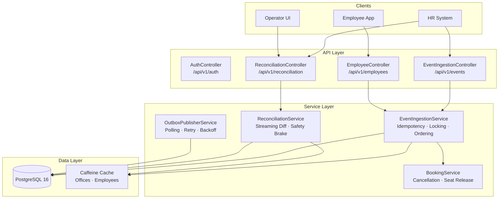
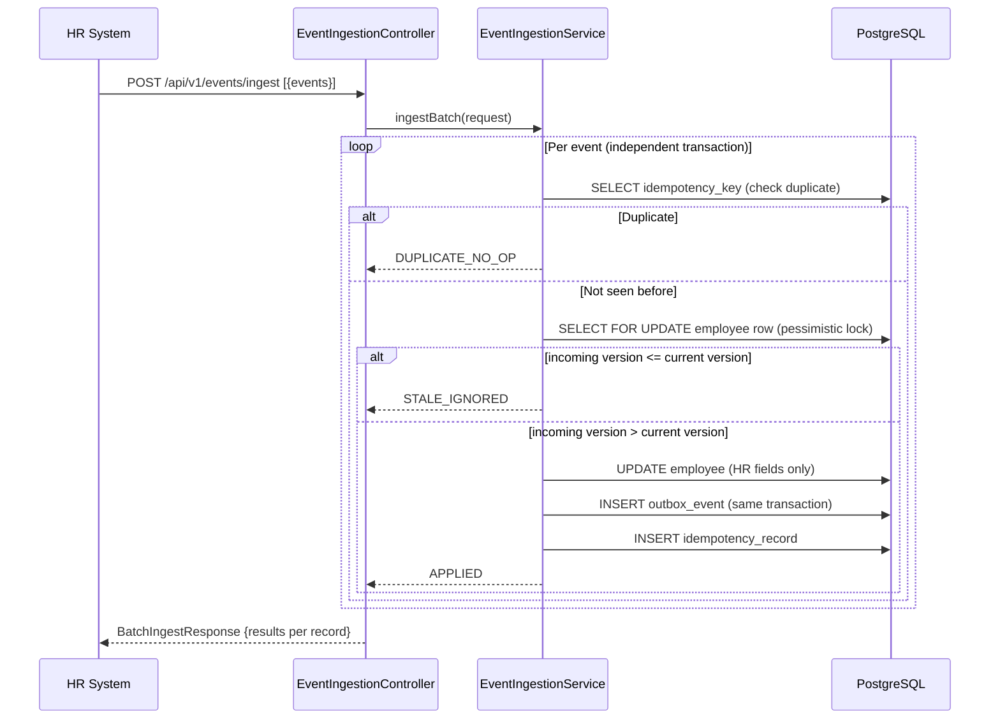
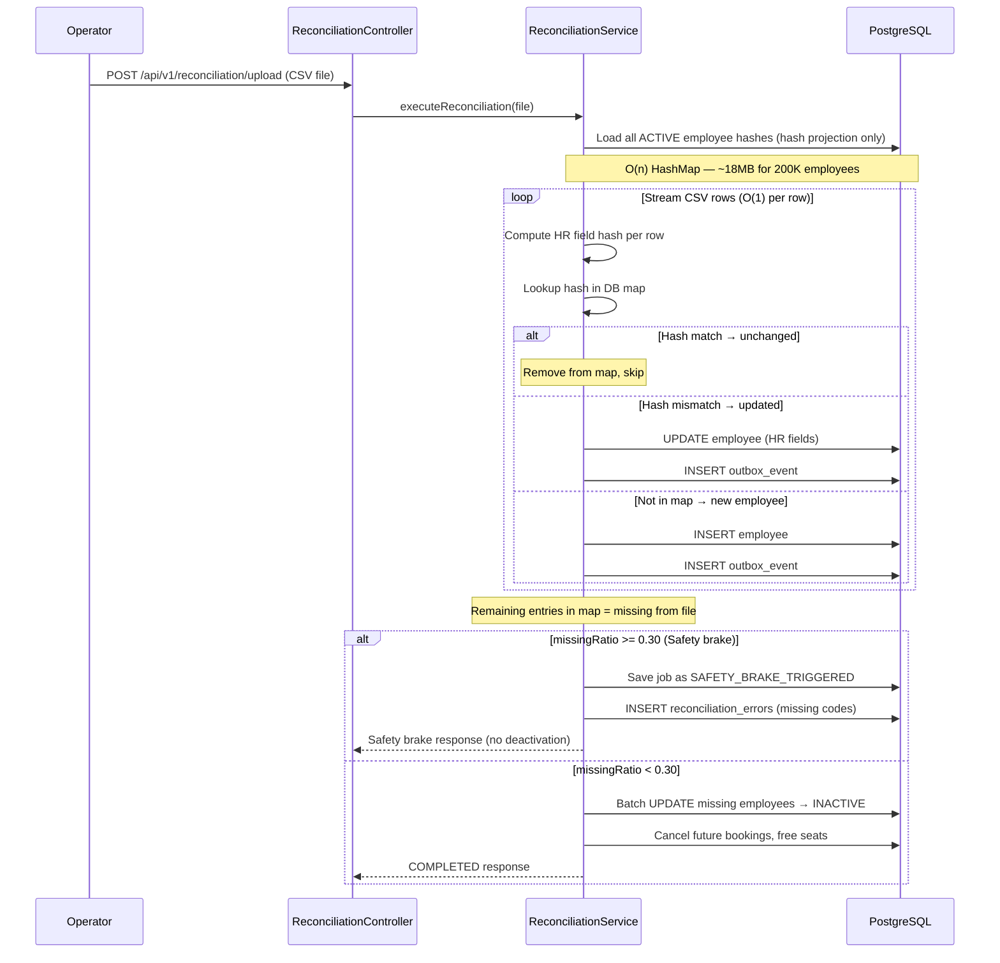
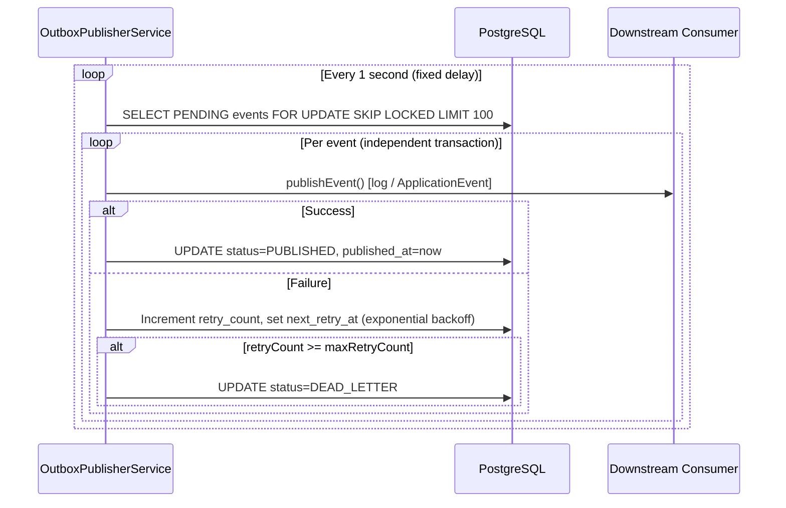
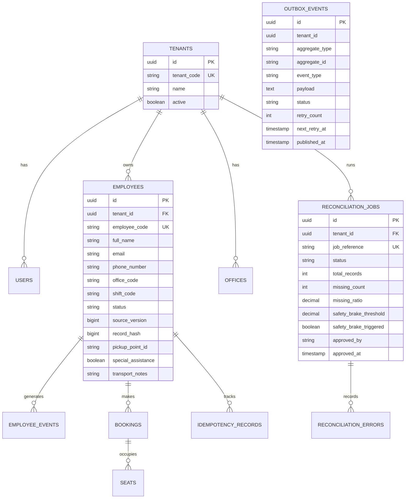

# MoveInSync HR Roster Sync

**Backend Engineering Hiring Assessment — Case Study 5**
**SDE Advanced Track (IIIT & NIT) — Java 21 / Spring Boot 3**

---

## Table of Contents

1. [Project Overview](#1-project-overview)
2. [Architecture](#2-architecture)
3. [Technology Stack](#3-technology-stack)
4. [Database Design](#4-database-design)
5. [How to Run](#5-how-to-run)
6. [Authentication](#6-authentication)
7. [API Reference](#7-api-reference)
8. [Core Design Decisions](#8-core-design-decisions)
9. [Reconciliation Algorithm](#9-reconciliation-algorithm)
10. [Safety Brake & Approval Workflow](#10-safety-brake--approval-workflow)
11. [Transactional Outbox](#11-transactional-outbox)
12. [Security & Multi-Tenancy](#12-security--multi-tenancy)
13. [Caching Strategy](#13-caching-strategy)
14. [Observability & Metrics](#14-observability--metrics)
15. [Failure Recovery](#15-failure-recovery)
16. [Time & Space Complexity](#16-time--space-complexity)
17. [Performance Benchmark Target](#17-performance-benchmark-target)
18. [Testing](#18-testing)
19. [Trade-offs & Known Limitations](#19-trade-offs--known-limitations)

---

## 1. Project Overview

Corporate clients keep their employee list in an HR system and push changes to MoveInSync: new joiners, transfers, shift changes, and exits. A nightly CSV export of up to 200,000 employees is also provided.

In practice, updates arrive **twice**, arrive **out-of-order**, contain **bad data**, and are sometimes **cut short**. Some fields belong to HR; some belong to the transport admin.

This system keeps MoveInSync's employee records correct regardless of these real-world problems.

### Key guarantees

| Guarantee | Mechanism |
|-----------|-----------|
| Duplicate events are no-ops | Idempotency keys in PostgreSQL |
| Stale versions are rejected | Per-employee source version monotonicity |
| Field ownership is preserved | HR/Transport field segmentation with explicit ownership rules |
| Nightly CSV diff is memory-safe | Streaming CSV parser + hash-projection map |
| Truncated exports don't wipe employees | Configurable safety brake (default 30%) |
| Employee updates and downstream events are atomic | Transactional outbox pattern |
| Cab bookings cancelled on deactivation | Deactivation side-effect with seat release |
| Multi-tenant isolation | Every query is tenant-scoped; tenant context in ThreadLocal |

---

## 2. Architecture



### Sequence: Employee event ingestion



### Sequence: Nightly reconciliation



### Sequence: Outbox publishing



---

## 3. Technology Stack

| Component | Choice | Reason |
|-----------|--------|--------|
| Language | Java 21 | Case study requirement; virtual threads ready |
| Framework | Spring Boot 3.3.5 | Productive, production-grade |
| Database | PostgreSQL 16 | ACID, JSON, `FOR UPDATE SKIP LOCKED` |
| ORM | Spring Data JPA / Hibernate | Type-safe queries, projections |
| Migrations | Flyway | Versioned, repeatable schema |
| Auth | JJWT 0.12.6 + Spring Security 6 | Stateless JWT, RBAC |
| Caching | Caffeine | High-throughput in-process cache |
| Metrics | Micrometer + Actuator | Prometheus-compatible |
| CSV Parsing | Jackson Dataformat CSV | Streaming, low-memory |
| Testing | JUnit 5 + Mockito | Unit and slice tests |
| Containers | Docker + Docker Compose | One-command startup |

---

## 4. Database Design



### Table purposes

| Table | Purpose |
|-------|---------|
| `tenants` | One row per client organization. All data is scoped to a tenant. |
| `users` | Application users with roles (EMPLOYEE, TRANSPORT_ADMIN, OPERATOR). |
| `employees` | Master employee roster. HR fields and transport fields are in the same row but owned separately. |
| `employee_events` | Audit log of every ingested event. |
| `idempotency_records` | Deduplication store keyed by `tenantId:employeeCode:sourceVersion`. |
| `outbox_events` | Transactional outbox. Events are committed atomically with the employee mutation. |
| `bookings` | Employee cab bookings. Future confirmed bookings are cancelled on deactivation. |
| `seats` | Vehicle seats. Released when corresponding bookings are cancelled. |
| `offices` | Valid office codes per tenant. Used for boundary validation. |
| `reconciliation_jobs` | One record per nightly reconciliation run, tracking diff statistics and safety-brake state. |
| `reconciliation_errors` | Per-row validation errors and missing employee records from a reconciliation run. |

---

## 5. How to Run

### Prerequisites

- Docker Desktop installed and running
- Java 21 and Maven 3.9+ (for local development only)

### One-command startup

```bash
docker compose up --build
```

This starts PostgreSQL and the application. Flyway migrations run automatically on startup.

### Verify the application is healthy

```bash
curl http://localhost:8080/actuator/health
```

Expected response:
```json
{"status": "UP"}
```

### Running locally (without Docker)

```powershell
# Set Java and Maven paths (Windows)
$env:JAVA_HOME = "C:\Program Files\Microsoft\jdk-21.0.13.21-hotspot"
$env:PATH = "$env:JAVA_HOME\bin;C:\Tools\apache-maven-3.9.16\bin;$env:PATH"

# Start PostgreSQL separately (or use docker compose up postgres)
# Then run the app
mvn spring-boot:run
```

---

## 6. Authentication

All protected endpoints require a Bearer JWT token.

### Login

```http
POST /api/v1/auth/login
Content-Type: application/json

{
  "tenantCode": "TENANT_ALPHA",
  "username": "operator_alpha",
  "password": "password123"
}
```

Response:
```json
{
  "success": true,
  "data": {
    "token": "eyJhbGci...",
    "tokenType": "Bearer",
    "role": "ROLE_OPERATOR",
    "tenantCode": "TENANT_ALPHA"
  }
}
```

All subsequent requests must include:
```http
Authorization: Bearer <token>
X-Tenant-ID: TENANT_ALPHA
```

### Roles

| Role | Permitted operations |
|------|---------------------|
| `ROLE_OPERATOR` | Event ingestion, reconciliation, approval/rejection |
| `ROLE_TRANSPORT_ADMIN` | Transport profile updates |
| `ROLE_EMPLOYEE` | Read own employee record, bookings |

---

## 7. API Reference

### Event Ingestion

#### Batch ingest
```http
POST /api/v1/events/ingest
Authorization: Bearer <token>
Content-Type: application/json

{
  "events": [
    {
      "eventType": "CREATE",
      "employeeCode": "EMP_1001",
      "sourceVersion": 1,
      "fullName": "Alice Smith",
      "email": "alice@company.com",
      "phoneNumber": "+919876543210",
      "officeCode": "BLR_ECOSPACE",
      "shiftCode": "SHIFT_0900",
      "status": "ACTIVE"
    }
  ]
}
```

Response:
```json
{
  "success": true,
  "data": {
    "totalReceived": 1,
    "appliedCount": 1,
    "rejectedCount": 0,
    "results": [
      {
        "employeeCode": "EMP_1001",
        "outcome": "APPLIED",
        "appliedVersion": 1
      }
    ]
  }
}
```

Possible `outcome` values:

| Value | Meaning |
|-------|---------|
| `APPLIED` | Event was applied; employee state updated |
| `DUPLICATE_NO_OP` | Same event seen before; no change made |
| `STALE_IGNORED` | Incoming version < current version; ignored |
| `VALIDATION_FAILED` | Record failed boundary validation |

#### Deactivate example
```json
{
  "eventType": "DEACTIVATE",
  "employeeCode": "EMP_1001",
  "sourceVersion": 5,
  "status": "INACTIVE"
}
```
Side effects: future cab bookings cancelled, seats freed, outbox event created.

### Reconciliation

#### Upload nightly CSV
```http
POST /api/v1/reconciliation/upload
Authorization: Bearer <operator-token>
Content-Type: multipart/form-data

file=<nightly_export.csv>
```

CSV format (header row required):
```csv
employee_code,full_name,email,phone_number,manager_employee_code,office_code,shift_code,status
EMP_1001,Alice Smith,alice@company.com,+919876543210,,BLR_ECOSPACE,SHIFT_0900,ACTIVE
```

Response (safety brake not triggered):
```json
{
  "success": true,
  "message": "Reconciliation completed: 500 created, 1200 updated, 198000 unchanged, 300 deactivated.",
  "data": {
    "jobId": "...",
    "status": "COMPLETED",
    "totalRecords": 200000,
    "createdRecords": 500,
    "updatedRecords": 1200,
    "unchangedRecords": 198000,
    "missingCount": 300,
    "missingRatio": 0.0015,
    "safetyBrakeTriggered": false
  }
}
```

Response (safety brake triggered):
```json
{
  "success": true,
  "message": "Safety brake triggered: 70000 employees (35.00%) missing. Operator approval required.",
  "data": {
    "status": "SAFETY_BRAKE_TRIGGERED",
    "missingCount": 70000,
    "missingRatio": 0.35,
    "safetyBrakeThreshold": 0.30,
    "safetyBrakeTriggered": true
  }
}
```

#### Get job status
```http
GET /api/v1/reconciliation/jobs/{jobReference}
GET /api/v1/reconciliation/jobs/latest
```

#### List pending approvals
```http
GET /api/v1/reconciliation/approvals
```

#### Approve (operator proceeds with deactivation)
```http
POST /api/v1/reconciliation/batches/{jobReference}/approve
Content-Type: application/json

{
  "operatorNotes": "Verified with HR team — file is genuine, please proceed."
}
```

#### Reject (no employees deactivated)
```http
POST /api/v1/reconciliation/batches/{jobReference}/reject
Content-Type: application/json

{
  "operatorNotes": "File appears truncated, re-export requested from HR team."
}
```

#### Get job errors
```http
GET /api/v1/reconciliation/jobs/{jobReference}/errors
```

---

## 8. Core Design Decisions

### A. Field Ownership

| Field | Owner | Rule |
|-------|-------|------|
| `full_name`, `email`, `phone_number` | HR | Ingestion and reconciliation update these; transport endpoints cannot |
| `manager_employee_code`, `office_code`, `shift_code`, `status` | HR | Same |
| `pickup_point_id`, `special_assistance`, `transport_notes` | Transport Admin | Only `PUT /employees/{code}/transport` may update these |

When an HR event arrives, transport-owned fields on the existing entity are **preserved** even if the incoming event payload includes them.

### B. Idempotency Key Strategy

```
idempotency_key = tenantId + ":" + employeeCode + ":" + sourceVersion
```

Before applying any event, the service checks the `idempotency_records` table for this key. If found, the event is a no-op and the previous outcome is returned. If not found, the event is processed and the key is inserted **in the same transaction** as the employee mutation.

### C. Version Ordering

```
incoming_version < current_version  → STALE_IGNORED  (no DB write, no outbox event)
incoming_version = current_version  → DUPLICATE_NO_OP (idempotency key already present)
incoming_version > current_version  → APPLIED
```

Version comparison is performed **after acquiring a pessimistic write lock** on the employee row, which serializes concurrent updates to the same employee.

### D. Pessimistic Locking

```sql
SELECT ... FROM employees WHERE tenant_id = ? AND employee_code = ? FOR UPDATE
```

This prevents two threads from reading the same stale version concurrently and both deciding to apply their update.

---

## 9. Reconciliation Algorithm

### Algorithm design

**Phase 1 — Load DB hash map (O(n) memory, bounded)**

Query all ACTIVE employee hash projections from the database into a `HashMap<String, Long>`.

Each entry contains: `(employeeCode, recordHash)` only — not the full entity.

Memory estimate for 200,000 employees:
- HashMap entry overhead: ~90 bytes
- 200,000 × 90 bytes ≈ **~18 MB**

This is bounded. It grows linearly with the number of ACTIVE employees, not with CSV file size or employee entity size.

**Phase 2 — Stream CSV rows (O(1) per row)**

The Jackson CSV streaming parser reads one row at a time from the HTTP input stream. The entire CSV file is never held in memory simultaneously.

For each row:
1. Compute a deterministic 64-bit hash of the HR-owned fields.
2. Look up `employeeCode` in the Phase-1 HashMap.
3. If found and hashes match → **unchanged** (remove from map).
4. If found and hashes differ → **updated** (apply HR fields, emit outbox event, remove from map).
5. If not found → **new employee** (create, emit outbox event).

**Phase 3 — Safety brake check**

After streaming, all entries remaining in the HashMap were active in the DB but absent from the CSV file (i.e., missing employees).

```
missingRatio = remainingMapSize / originalDbCount

if missingRatio >= threshold (default 0.30):
    → SAFETY_BRAKE_TRIGGERED
    → No deactivation occurs
    → Missing employee codes persisted to reconciliation_errors
    → Job status = SAFETY_BRAKE_TRIGGERED
    → Human review and approval required

else:
    → Batch deactivate missing employees in chunks of 2000
    → Cancel future bookings for each deactivated employee
    → Job status = COMPLETED
```

**Complexity summary**

| Phase | Time | Space |
|-------|------|-------|
| Load DB hashes | O(n) | O(n) — ~18 MB for 200K |
| Stream CSV | O(m) | O(1) per row |
| Safety brake check | O(k) | O(1) |
| Batch deactivation | O(k) | O(batch_size) |
| **Total** | O(n + m) | O(n) |

Where n = active employees in DB, m = CSV rows, k = missing employees.

The dominant memory cost is the Phase-1 hash map. This is **not** O(1) total — it is O(n). However, n is bounded by the actual employee population (up to 200,000), and the per-entry size is minimal (~90 bytes). For 200,000 employees the peak footprint is approximately 18 MB, well within standard JVM heap allocation.

### Record hash

The employee record hash uses a 64-bit Murmur3-style algorithm over the canonical pipe-separated concatenation of HR-owned fields:

```
hash( normalize(fullName) | normalize(email) | normalize(phone) |
      normalize(managerCode) | normalize(officeCode) |
      normalize(shiftCode) | normalize(status) )
```

`normalize()` → `trim().toLowerCase()`. This makes the hash deterministic across runs and case-insensitive.

---

## 10. Safety Brake & Approval Workflow

### Threshold

```yaml
moveinsync:
  reconciliation:
    safety-brake-threshold: 0.30   # 30%
```

The threshold is configurable without a code change.

### State machine

```
IN_PROGRESS → COMPLETED                (normal path, <30% missing)
IN_PROGRESS → SAFETY_BRAKE_TRIGGERED  (>=30% missing)
SAFETY_BRAKE_TRIGGERED → APPROVED     (operator approves deactivation)
SAFETY_BRAKE_TRIGGERED → REJECTED     (operator cancels — no deactivation)
IN_PROGRESS → FAILED                  (unhandled processing error)
```

### Boundary conditions

| Scenario | Behaviour |
|----------|-----------|
| Missing ratio < 30% | Normal completion, deactivation proceeds |
| Missing ratio exactly 30% | Safety brake triggers (>= threshold) |
| Missing ratio > 30% | Safety brake triggers |
| Zero active employees in DB | missingRatio = 0, no safety brake |
| Empty CSV | All DB employees flagged as missing; safety brake likely triggers |

### Approval idempotency

The approval endpoint checks `job.status == SAFETY_BRAKE_TRIGGERED` before proceeding. A second approval attempt on an already-APPROVED job returns an error — no double-deactivation is possible.

---

## 11. Transactional Outbox

### Why

The employee mutation (UPDATE employees) and the downstream notification (INSERT outbox_events) are committed in the **same database transaction**. If the transaction rolls back, neither mutation nor event exists. If it commits, both exist permanently.

This eliminates the problem of:
- Employee updated, then application crashes before publishing → event silently lost
- Publish succeeds, then transaction rolls back → ghost event with no corresponding employee change

### Publisher

`OutboxPublisherService` polls every second using `FOR UPDATE SKIP LOCKED`:

```sql
SELECT * FROM outbox_events
WHERE status = 'PENDING' AND next_retry_at <= NOW()
ORDER BY created_at ASC
LIMIT 100
FOR UPDATE SKIP LOCKED
```

`SKIP LOCKED` allows multiple publisher instances to run concurrently without contention. Each instance takes a different batch.

### Retry and dead-letter

| Retry attempt | Next retry delay |
|--------------|-----------------|
| 1 | 5 seconds |
| 2 | 10 seconds |
| 3 | 20 seconds |
| 4 | 40 seconds |
| 5 | → DEAD_LETTER |

After 5 failures the event is moved to `DEAD_LETTER` status and never retried. An alert metric is incremented.

### Delivery guarantee

The outbox provides **at-least-once delivery**. If the publisher crashes after calling `publishEvent()` but before writing `status=PUBLISHED`, the event stays PENDING and is re-published on the next poll. Downstream consumers must be idempotent.

---

## 12. Security & Multi-Tenancy

- JWT tokens contain `tenantId`, `tenantCode`, `userId`, and `role`.
- `TenantFilter` extracts and validates the `X-Tenant-ID` header against the JWT claim.
- `TenantContext` stores `tenantId` and `tenantCode` in a `ThreadLocal` for the request duration.
- Every database query that touches employee, booking, outbox, or reconciliation data includes `WHERE tenant_id = ?`.
- No cross-tenant data is accessible regardless of what an authenticated user provides in a request body.

---

## 13. Caching Strategy

| Cache | Data | TTL | Invalidation |
|-------|------|-----|-------------|
| `offices_cache` | Valid office codes per tenant | 10 minutes | On office update |
| `employee_cache` | Individual employee records by code | 10 minutes | On ingestion/reconciliation update |
| `tenant_cache` | Tenant metadata by code | 10 minutes | Manual only |

**What can become stale:** An office code added to a tenant after the cache was populated will not be visible to the validator for up to 10 minutes.

**Bound on staleness:** 10 minutes (Caffeine TTL configured in `CacheConfig`).

**Cache size:** Maximum 50,000 entries per cache, with initial capacity 1,000. Eviction uses LRU when the limit is reached.

---

## 14. Observability & Metrics

All metrics are exposed at `/actuator/prometheus`.

| Metric | Type | Description |
|--------|------|-------------|
| `roster.events.received.total` | Counter | Total ingest events received |
| `roster.events.applied.total` | Counter | Events successfully applied |
| `roster.events.stale.total` | Counter | Events ignored as stale |
| `roster.events.duplicate.total` | Counter | Events detected as duplicates |
| `roster.events.rejected.total` | Counter | Events rejected by validation |
| `roster.outbox.published.total` | Counter | Outbox events successfully published |
| `roster.outbox.retried.total` | Counter | Outbox events retried after failure |
| `roster.outbox.dead_letter.total` | Counter | Outbox events moved to dead-letter |
| `roster.outbox.pending.total` | Gauge | Current count of PENDING outbox events |
| `roster.reconciliation.safety_brake.total` | Counter | Safety brakes triggered |

**Structured logging:** All logs include `traceId`, `tenantId`, and `employeeCode` MDC fields. Personal data (email, phone, address) is never logged directly — `PiiMasker` replaces them with `[email-redacted]` and `[phone-redacted]` patterns.

---

## 15. Failure Recovery

| Failure | Impact | Recovery |
|---------|--------|---------|
| App crash mid-ingestion | Each event has its own transaction; only in-flight events are affected | In-flight events are not committed; client retries them |
| App crash after DB commit, before outbox publish | Employee is updated, outbox event is PENDING | Outbox poller picks up PENDING event on next restart |
| PostgreSQL restart during reconciliation | Transaction rolls back; job remains IN_PROGRESS | Re-upload the CSV to start a new reconciliation job |
| Outbox publisher repeated failure | Event moves to DEAD_LETTER after 5 retries | Alert metric increments; manual investigation required |
| Duplicate CSV upload | Employees already in DB are detected as unchanged or updated based on hash; no double-deactivation | Idempotent by design |
| Safety brake on truncated file | No employees deactivated | Operator reviews job, either approves or rejects |

---

## 16. Time & Space Complexity

### Event ingestion (single event)

| Operation | Complexity |
|-----------|-----------|
| Idempotency key check | O(1) — indexed lookup on `tenant_id, idempotency_key` |
| Employee row lock | O(1) — indexed lookup on `tenant_id, employee_code` |
| Version comparison | O(1) |
| Employee update | O(1) |
| Outbox event insert | O(1) |
| **Total per event** | O(1) |

For a batch of N events processed with per-record fault isolation: **O(N)** time, **O(1)** space per event.

### Nightly reconciliation (n DB employees, m CSV rows)

| Phase | Time | Space |
|-------|------|-------|
| Load DB hash map | O(n) | O(n) — ~90 bytes/entry |
| Stream CSV | O(m) | O(1) per row |
| Safety brake check | O(k) | O(k) for missing set |
| Batch deactivation | O(k/B) batches × O(B) per batch | O(B) per batch |
| **Total** | O(n + m) | O(n) — dominated by hash map |

For n=200,000 employees: hash map ≈ **18 MB**. CSV streaming adds ≈ **1 row buffer** in memory.

**Scalability limit:** The hash map grows linearly with the number of ACTIVE employees. Beyond approximately 2 million employees, a staging-table approach (COPY into a temp table, then SQL JOIN diff) would be more appropriate.

---

## 17. Performance Benchmark Target

**Target:** Process a 200,000-row CSV in under 60 seconds with bounded memory.

**Environment to test on:** Machine running Docker Compose with default JVM settings (512MB heap).

The implementation is designed to meet this target due to:
1. O(1) per-row processing (streaming CSV, hash lookup).
2. Bulk batch updates (2,000 employees per batch deactivation).
3. No full-entity JPA loading for unchanged employees.
4. Hash comparison avoids unnecessary UPDATE statements.

> **Note:** An actual benchmark against a live PostgreSQL instance with 200,000 rows was not executed in the time available for this assessment. The algorithm complexity and implementation choices are designed to meet the target. The benchmark should be run with `docker compose up` and a synthetic CSV generator.

To generate a test CSV:
```bash
# Generates 200000_employees.csv
python3 -c "
import random
print('employee_code,full_name,email,phone_number,manager_employee_code,office_code,shift_code,status')
offices = ['BLR_ECOSPACE','HYD_HITEC','DEL_CYBERHUB','MUM_BKC','PUN_MAGARPATTA']
for i in range(200000):
    print(f'EMP_{i:06d},Name {i},emp{i}@company.com,+91{9000000000+i},,{random.choice(offices)},SHIFT_0900,ACTIVE')
" > 200000_employees.csv
```

---

## 18. Testing

### Run all tests

```powershell
$env:JAVA_HOME = "C:\Program Files\Microsoft\jdk-21.0.13.21-hotspot"
$env:PATH = "$env:JAVA_HOME\bin;C:\Tools\apache-maven-3.9.16\bin;$env:PATH"
mvn clean test
```

### Current test count: **40 tests, 0 failures**

| Test class | Tests | Covers |
|------------|-------|--------|
| `EventIngestionControllerIntegrationTest` | 3 | HTTP layer, JWT auth, role-based access |
| `EventIngestionServiceTest` | 5 | Create, stale ignore, duplicate no-op, deactivation, batch fault isolation |
| `BoundaryValidatorTest` | 4 | Phone validation, email validation, office code validation |
| `HashUtilsTest` | 2 | Hash determinism, normalisation |
| `PiiMaskerTest` | 2 | Email masking, phone masking |
| `ReconciliationServiceTest` | 10 | All-unchanged, safety brake at/above/below 30%, empty CSV, approval, rejection, invalid state, zero DB employees, tenant isolation |
| `OutboxPublisherServiceTest` | 6 | Happy path publish, no-op on empty queue, retry counter, dead-letter, exponential backoff, batch size |
| `ConcurrencyTest` | 3 | Simultaneous duplicates → exactly 1 APPLIED, out-of-order stale version rejection, cross-employee isolation |
| `FailureInjectionTest` | 5 | Crash recovery, publish failure stays PENDING, retry exhaustion → dead-letter, dead-letter not re-polled, at-least-once delivery |

---

## 19. Trade-offs & Known Limitations

| Trade-off | Decision | Rationale |
|-----------|----------|-----------|
| In-memory hash map vs staging table | Hash map | Simpler, ~18MB for 200K is acceptable; staging table adds schema/migration complexity |
| At-least-once vs exactly-once outbox | At-least-once | Exactly-once requires distributed transaction coordinator; overkill for this assessment |
| Single DB vs message broker | Single DB | No Kafka/Redis; PostgreSQL FOR UPDATE SKIP LOCKED is sufficient for the stated scale |
| Modular monolith vs microservices | Monolith | Case study does not require independent deployment; reduces operational complexity |
| Unit tests vs Testcontainers integration tests | Primarily unit | Testcontainers requires Docker in CI; unit tests run anywhere. Real lock behavior needs Testcontainers for full proof. |
| Cache TTL 10 minutes | 10 minutes | Balance between freshness and load; office codes change rarely |
| Benchmark | Not executed | Would require a dedicated test run with Docker; timing stated as a target rather than a measured result |

### What was deliberately left out

- Kafka, Redis, or any external message broker.
- Separate microservices.
- GraphQL API.
- Distributed tracing (OpenTelemetry).
- Testcontainers PostgreSQL concurrency tests (would prove the `FOR UPDATE` lock behavior definitively; unit tests simulate it with Mockito).
- Actual load test execution (200,000-row benchmark target is stated but not measured due to time constraint).
